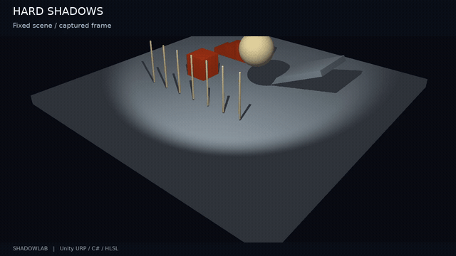
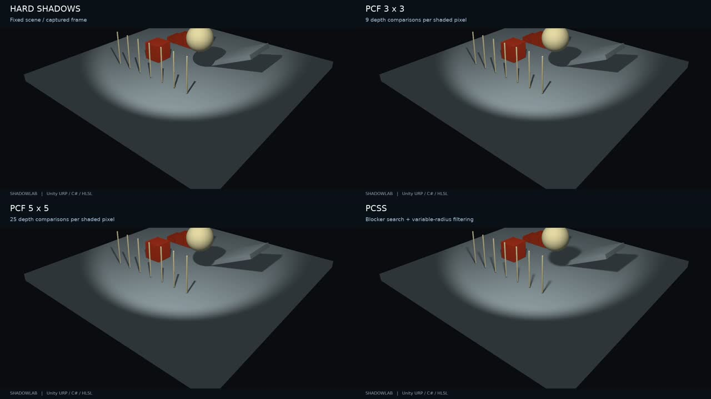

# ShadowLab

An interactive shadow-quality lab in **Unity URP, C# and HLSL**: compare hard shadows, PCF and contact-hardening PCSS, then inspect the quality / GPU-time tradeoff.

The animation above plays automatically and loops (640×360, 8 fps). **[Download the full-quality MP4 (1280×720)](https://raw.githubusercontent.com/DonGCoco/ShadowLab/main/Media/ShadowLab_Demo.mp4)** · [Implementation notes](Docs/ALGORITHMS.md) · [Measured results](Docs/RESULTS.md)

## What it demonstrates

- A custom spotlight shadow pass: opaque mesh submission, light matrices, RFloat linear light-depth map and a separate visibility depth buffer.
- Hard shadows, 3×3 / 5×5 PCF, and PCSS with 32 blocker-search samples plus up to 32 filter samples.
- Interactive shadow resolution, bias, PCF spacing, emitter radius, sphere height and footprint caps.
- Optional geometric receiver-plane depth correction to reduce false self-shadowing during wide filtering.
- A depth-map preview and repeatable capture tooling with raw GPU samples and condition metadata.

Captured frames from the same recorded scene. The images illustrate appearance; they are not a reference-renderer accuracy test.

## Initial measurements

Apple M1 · Metal · standalone macOS Player · Unity 6000.3.24f1 · 2560×1600 output · 1024² shadow map.

| Mode | Median GPU frame time | P95 |
|---|---:|---:|
| Hard | 3.923 ms | 5.379 ms |
| PCF 3×3 | 4.561 ms | 5.892 ms |
| PCF 5×5 | 5.516 ms | 6.974 ms |
| PCSS | 7.837 ms | 9.545 ms |

**Total-frame GPU time, one run per mode, 300 valid samples each.** These are not isolated shadow-pass timings. [Method, limitations and raw data](Docs/RESULTS.md).

## Run on Mac

This repository supplies an **Assets module**, rather than a complete Unity Hub project.

1. Create a **Universal 3D (URP)** project in Unity Hub. The demonstrated host uses Unity **6000.3.24f1** and Metal.
2. Copy `Assets/ShadowLab` into your project's `Assets`. Keep your project's Packages and ProjectSettings.
3. Wait for compilation, then choose **ShadowLab → Create Demo Scene** and save to a new scene path.
4. Open Game view and press Play. Disable animation for comparisons.
5. Start with Baseline, 1024 and receiver-plane correction enabled. Compare Hard / PCF / PCSS.
6. For PCSS, vary **Emitter radius** at fixed height, then **Sphere center height** at fixed emitter radius. Scroll the control panel for more options.

To update an existing installation, exit Play mode and replace the module's source files while preserving existing `.meta` files. [Capture instructions](Docs/BENCHMARK.md).

## Engineering focus

The most useful debugging cases were incorrect projection / texture conventions, a depth preview that failed to display actual stored values, and wide-filter self-shadow stripes. The implementation separates depth generation, visualization and receiver comparisons so these failures can be examined independently. [Validation record](Docs/VALIDATION.md).

The shadow map is submitted before URP camera rendering through an explicit command buffer; it is independent of URP's shadow atlas. The receiver shader implements custom spotlight diffuse lighting. Additional casters must be registered in the controller and use the supported mesh path.

## Scope

This is an educational implementation of established algorithms, developed with AI assistance and iteratively tested on the author's Mac. It is not a new shadow algorithm or production-ready URP lighting integration.

Only opaque MeshRenderer geometry is supported; transform animation is supported, but skinned meshes and alpha clipping are not. PCSS uses sparse samples and bounded footprints: thin blockers can be missed, caps can truncate penumbrae, and motion artifacts remain possible. The diffuse light remains a point spotlight; PCSS approximates area-light visibility rather than integrating full area lighting.

## Source guide

| File | Responsibility |
|---|---|
| [Controller](Assets/ShadowLab/Runtime/ShadowLabController.cs) | Resources, light transforms, shadow submission and controls |
| [Linear depth shader](Assets/ShadowLab/Shaders/LinearDepth.shader) | Depth generation and preview |
| [Receiver shader](Assets/ShadowLab/Shaders/Receiver.shader) | Lighting, comparison, PCF, receiver-plane correction and PCSS |
| [Benchmark collector](Assets/ShadowLab/Runtime/ShadowLabBenchmark.cs) | GPU frame collection and export |
| [Scene builder](Assets/ShadowLab/Editor/ShadowLabSceneBuilder.cs) | Reproducible test geometry |

[Algorithm notes](Docs/ALGORITHMS.md) · [Benchmark procedure](Docs/BENCHMARK.md) · [Interview preparation / 面试说明](Docs/INTERVIEW_NOTES.md) · [Roadmap](Docs/ROADMAP.md)

CPU geometry checks: `python3 -m unittest discover -s Tests -v`. These checks do not compile Unity shaders or validate GPU output.

